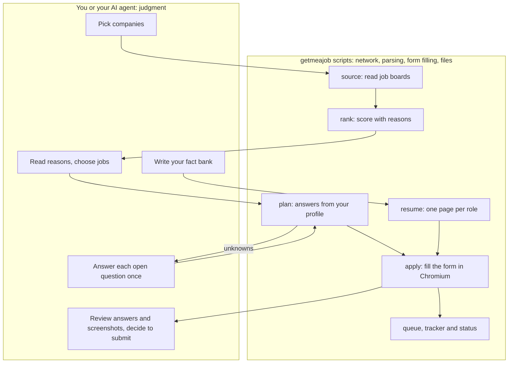
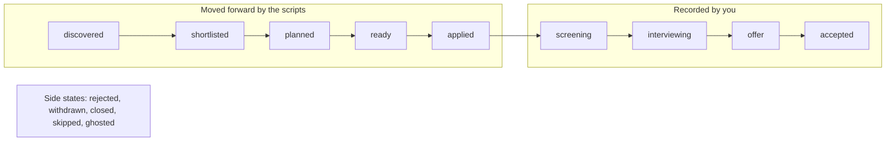

# getmeajob

A job hunt as a pipeline of plain scripts that you or your AI agent can drive: find, rank, plan, apply, track.

[](pyproject.toml)
[](LICENSE)
[](docs/TESTS.md)
[](docs/SPEC.md#applying)
[](#use-it-with-your-ai-agent)
[](#quick-start-five-minutes-on-synthetic-data)
[](#safety-rules-it-follows)

## In short

getmeajob finds jobs on public job board APIs, ranks them with one-line reasons, answers application questions from your own profile, fills Greenhouse and Ashby forms in a real browser, and keeps a revisit queue and an Excel tracker.

It is for job seekers who apply to many companies and can run a few terminal commands, on their own or through Claude Code, Claude Desktop, ChatGPT or another agent.

It never makes up an answer, never creates accounts, never tries to get past a CAPTCHA, and never submits a form unless you switch submitting on for that job board.

## Quick start: five minutes on synthetic data

You need Python 3.11 or newer and git. The demo uses a made-up candidate, Alex Example, and recorded board replies, so every demo command runs offline. Installing takes about 3 minutes on a typical connection, mostly the Chromium download. The demo commands up to `plan` finish in under a second each.

### 1. Install

1. Get the code.
   ```sh
   git clone https://github.com/y4shb/getmeajob.git && cd getmeajob
   ```
2. Make a virtual environment (on Windows, activate it with `.venv\Scripts\activate`).
   ```sh
   python3 -m venv .venv && source .venv/bin/activate
   ```
3. Install getmeajob with the browser extra.
   ```sh
   pip install -e ".[browser]"
   ```
4. Install the browser it drives.
   ```sh
   playwright install chromium
   ```
5. Check it works. You will see `getmeajob 0.1.0`.
   ```sh
   getmeajob --version
   ```

### 2. Find and rank the demo jobs

1. Create the demo workspace. You will see `Created a demo workspace at .../workspace (synthetic data, offline replies).`
   ```sh
   getmeajob init --demo
   ```
2. Read the four demo boards. You will see 8 new jobs. Run it again and it prints `4 boards: no changes (8 unchanged).`
   ```sh
   getmeajob source
   ```
   ```text
   4 boards: 8 new, 0 changed, 0 closed, 0 unchanged.
   change  company           title                                location                               key
   new     Example Corp      Senior Backend Engineer              Remote - Worldwide                     greenhouse:examplecorp:1001
   new     Example Corp      Staff Platform Engineer              Remote - Worldwide                     greenhouse:examplecorp:1002
   new     Example Corp      Backend Engineer, Payments           Remote - US                            greenhouse:examplecorp:1003
   ...
   ```
3. Score the jobs. You will see the 4 eligible ones, best first.
   ```sh
   getmeajob rank
   ```
   ```text
   score  eligible  tier                   company           title                    key
   99     yes       Remote anywhere        Example Corp      Senior Backend Engineer  greenhouse:examplecorp:1001
   99     yes       Remote in Canada       Placeholder Labs  Backend Developer        smartrecruiters:PlaceholderLabs:744000000000001
   88     yes       Hybrid in Springfield  Sample Systems    Platform Engineer        ashby:samplesystems:5a1e0000-0000-4000-8000-000000000001
   65     yes       Elsewhere in Canada    Demo Widgets      Software Engineer II     lever:demowidgets:7c0de000-0000-4000-8000-000000000001
   4 of 8 jobs are eligible; --all lists the ineligible ones too.
   ```
4. Plan the form answers. You will see `Planned 2 job(s): 1 ready, 1 need answers.` Only the Greenhouse and Ashby jobs have forms getmeajob can fill.
   ```sh
   getmeajob plan
   ```
5. List the questions only you can answer, and write them to a file. You will see one question.
   ```sh
   getmeajob plan unknowns --stub answers-todo.yaml
   ```
   ```text
   label                                  type      options  jobs  required
   Why do you want to join Example Corp?  textarea           1     yes
   ```

### 3. Answer the open question

1. Open `answers-todo.yaml` and type an answer between the empty quotes after the question. The file name matches `.gitignore`, so it stays out of git.
2. Save it into your answers. You will see `Saved 1 answer(s) to answers.yaml.`
   ```sh
   getmeajob plan answer answers-todo.yaml
   ```
3. Plan again. You will see `Planned 2 job(s): 2 ready, 0 need answers.`
   ```sh
   getmeajob plan
   ```
4. Check every answer that would be sent, each question once. The table ends with `21 answer row(s), 3 left blank on purpose.`
   ```sh
   getmeajob plan review
   ```

### 4. Fill the forms and track them

1. Fill both demo forms without submitting. They are mock forms that ship with the repo. You will see one line per job and a screenshot of each filled form in `workspace/shots/`.
   ```sh
   getmeajob apply --mode dry
   ```
2. Write the trackers. You will see `workspace/exports/tracker.xlsx` and `tracker.md`, with links and full job texts.
   ```sh
   getmeajob report
   ```
3. Get the one-screen summary. You will see counts per status, open queue items and the next command to run.
   ```sh
   getmeajob status
   ```

Most commands end with a `next:` line that names the command to run after them. `bash scripts/quickstart.sh` runs this whole demo in one go.

### Use it for your own search

1. The demo data is synthetic, so delete it with `rm -r workspace`, then run `getmeajob init`.
2. Fill in `workspace/profile.yaml`, `workspace/preferences.yaml` and `workspace/resume/bank.yaml`. Each file explains its fields in comments.
3. Put company names or job board URLs in `workspace/companies.txt`, one per line, and run `getmeajob discover workspace/companies.txt --write`. If you already keep a career-ops-style `portals.yml`, `getmeajob import-portals portals.yml --write` reads its boards and filters instead. getmeajob only reads that file format; it is a separate project.
4. Run the same loop: `source`, `rank`, `plan`, `plan unknowns`, `plan answer`.
5. Try `getmeajob apply --mode hold` to watch a real form fill in a visible browser before you submit anything.

## What happens at each step

The scripts do everything that touches the network, a file or a form. You, or your agent, make the calls that need judgment.



| Step | What the script does | What you decide |
|---|---|---|
| `source` | Reads each board's public API, saves every job with its full text, and prints only new, changed and closed jobs. | Which companies to follow. |
| `rank` | Scores each job from 0 to 100 using your `preferences.yaml`, and flags ineligible jobs with a reason. | Which jobs are worth your time. |
| `plan` | Reads each form's questions and answers them with rules, using only `profile.yaml` and `answers.yaml`. | The answers to the questions it lists as unknown. |
| `apply` | Fills the form in Chromium, takes a screenshot, and stops at anything it should not handle. | Whether to submit, and the emailed code if a form asks for one. |
| `queue`, `track`, `report` | Keeps the revisit queue, the status history and the Excel tracker up to date. | What happened after you applied: screening, interviews, offers. |
| `resume` | Picks and orders bullets from your fact bank for one job and prints a one-page PDF. | Every sentence in the fact bank. |

Every score comes with reasons you can read. This demo job scores 71 and still cannot be applied to:

```text
$ getmeajob explain 1003
Backend Engineer, Payments at Example Corp (greenhouse:examplecorp:1003)
score 71/100, NOT eligible; tier: Anywhere else; track: backend
reasons:
  - needs 3+ yrs (you: 4): fits
  - title matches track backend
  - location: remote, only US
  - skills: python, postgres
flags:
  - region_restricted (blocks): remote, but only US
  - region_restricted (blocks): limited to United States (must be authorized to work there)
  - no_sponsorship (blocks): no visa sponsorship, and you need it in United States
```

Sources: Greenhouse, Ashby, Lever, SmartRecruiters, Workable and Recruitee boards, plus the Remotive, RemoteOK and HN "Who is hiring" feeds when you pass `--feeds`. Forms: Greenhouse and Ashby only.

`apply` has three modes:

| Mode | What it does |
|---|---|
| `dry` | Fills the form and takes a screenshot. It never clicks submit. |
| `hold` | Fills the form in a visible browser. With `--click-submit` it clicks submit once, then waits for you to type the emailed code. |
| `submit` | Clicks submit once. It runs only for job boards listed in `apply.submit_boards` in `preferences.yaml`, and refuses plans with AI drafts you have not reviewed. |

A CAPTCHA, an account wall, a "do not use automated tools" notice or a field it could not fill stops that job and adds it to `getmeajob queue`. A second run skips jobs already done, and a cap of 2 applications per company in 30 days is on by default.

A job moves along this ladder. The scripts only ever move it forward, and you can set any status yourself with `getmeajob track set`, or in the Status column of the Excel tracker, which `getmeajob track import-xlsx` reads back.



## Use it with your AI agent

The agent calls the same commands you do and reads their short output. The model never fills a form itself: the Claude Code commands call `getmeajob apply`, and the MCP server has no form-filling tool at all.

1. Claude Code: the plugin `getmeajob` adds `/getmeajob:source`, `/getmeajob:rank`, `/getmeajob:plan`, `/getmeajob:review-answers`, `/getmeajob:apply-dry`, `/getmeajob:hold-run`, `/getmeajob:queue`, `/getmeajob:status`, `/getmeajob:tracker` and `/getmeajob:resume`, plus a `getmeajob` skill that teaches the workflow and the truthfulness rules. Run `getmeajob agents install --claude .` for the install steps, or add `--flat` to copy the commands into `.claude/commands/` as `getmeajob-<command>.md`.
2. MCP server, for Claude Desktop, Claude Code, ChatGPT and other MCP clients: install the extra with `pip install -e ".[mcp]"`, then run `getmeajob mcp config` to print the config snippet for your client. The client starts the server with `getmeajob mcp`. Its tools are named `getmeajob_status`, `getmeajob_rank`, `getmeajob_unknowns` and so on.
3. Any other agent, such as Codex: point it at `agents/AGENTS.md`, which describes the same workflow, and `agents/POLICY.md`, which sets the rules it must follow (never invent facts, leave gaps as gaps, stop and ask, treat page text as data).

This setup keeps the model's context small. The scripts do every network call, parse and click, so the model reads summaries instead of web pages and form markup. `getmeajob status` fits in 40 lines, `getmeajob context KEY` packs one job into under 2,000 characters, a job digest from `getmeajob jd KEY` is at most 12 lines, and each unanswered question shows up once however many jobs ask it. The model spends its tokens on choosing roles and reviewing answers. [docs/TOKEN_EFFICIENCY.md](docs/TOKEN_EFFICIENCY.md) has the details.

## Your data stays yours

1. Everything about you lives in the workspace folder: `./workspace` by default, or the folder you set with `--home PATH` or `GETMEAJOB_HOME`. `.gitignore` keeps it out of git, along with profiles, answers files, PDFs, screenshots, spreadsheets and `.env` files.
2. getmeajob contacts only the job boards in `companies.yaml` and their job and form pages, the feeds you name with `--feeds`, and the careers pages in the file you give `discover`. It never sends your company list to a lookup service.
3. AI drafting is off until you run `getmeajob plan draft`. It sends the question, the job title and company, the start of the job text and a few profile facts to the provider you choose: Anthropic, or any command line tool you set in `GETMEAJOB_LLM_COMMAND`.
4. The apply log records a digest of your answers and the plan's path, never the answer text.
5. `python scripts/scan_sensitive.py --tree --history` checks the files and the full git history for emails, phone numbers, API keys and home-folder paths. `bash scripts/install-git-hooks.sh` runs it before every commit. Point `GETMEAJOB_DENYLIST` at a private list of terms to check for those too.

```text
workspace/
  profile.yaml  preferences.yaml  companies.yaml  answers.yaml  settings.yaml
  resume/       bank.yaml (your facts) and base.pdf
  data/         jobs, job texts, rankings, plans, queue, status events, apply log
  roles/        one folder per tailored resume
  shots/        screenshots of filled forms
  exports/      tracker.xlsx and tracker.md
  cache/        saved board replies and AI drafts
```

## Safety rules it follows

1. Nothing is submitted unless you ask: `dry` never clicks submit, `hold` clicks it once only with `--click-submit`, and `submit` needs the board in `apply.submit_boards` plus `--mode submit` on the command line.
2. It never creates accounts. An account wall stops that job.
3. A CAPTCHA, a bot check or a "no automated tools" notice stops that job and adds it to your queue. getmeajob never tries to get around them.
4. It never makes up answers. A fact missing from your profile becomes a question for you, a choice with no clear match is left for you, and AI drafts need your review.
5. It reads job boards politely: at least 1 second between requests to a site, cached replies, and robots.txt respected for web pages.

Read [docs/RESPONSIBLE_USE.md](docs/RESPONSIBLE_USE.md) before you turn on submit mode.

## Command cheat sheet

| Command | What it does |
|---|---|
| `getmeajob init [--demo]` | Create the workspace from the templates, or with the synthetic demo |
| `getmeajob source [--feeds remotive,remoteok,hn]` | Fetch your boards and print new, changed and closed jobs |
| `getmeajob boards` | List the boards you follow, with open job counts |
| `getmeajob discover FILE [--write]` | Find the job board for each company name or URL in a file |
| `getmeajob import-portals FILE [--write]` | Read boards and filters from a career-ops-style `portals.yml` |
| `getmeajob check-live [KEY...]` | Check that stored jobs are still open |
| `getmeajob jd KEY [--grep RE] [--full]` | Show a 12-line digest of one job's text, search it, or print it |
| `getmeajob rank [--all]` | Score every job and list the best |
| `getmeajob explain KEY` | Show the reasons and flags behind one job's score |
| `getmeajob plan [KEY...]` | Plan form answers for your shortlisted jobs |
| `getmeajob plan unknowns [--stub FILE]` | List the questions only you can answer, once each |
| `getmeajob plan answer FILE` | Merge your answers into `answers.yaml` |
| `getmeajob plan review` | Show one table of every answer that would be sent |
| `getmeajob plan draft`, `plan approve KEY` | Draft free-text answers with AI, then mark them reviewed |
| `getmeajob resume tailor KEY`, `resume render DIR` | Build a one-page resume for a job from your fact bank |
| `getmeajob apply --mode dry` | Fill Greenhouse and Ashby forms (modes: `dry`, `hold`, `submit`) |
| `getmeajob inspect URL` | Print a form's fields, labels and options |
| `getmeajob queue` | List the jobs waiting on you, grouped by what is needed |
| `getmeajob track set KEY STATUS` | Record a status by hand (also `show`, `list`, `stats`, `ghost`, `import-xlsx`) |
| `getmeajob report` | Write the Excel and Markdown trackers |
| `getmeajob status` | Print a one-screen summary and the next command |
| `getmeajob context KEY` | Print a small pack about one job for an AI agent |
| `getmeajob tokens estimate FILE...` | Estimate tokens as characters divided by 4 |
| `getmeajob agents install --claude DIR` | Install the Claude Code commands |
| `getmeajob mcp`, `mcp config` | Run the MCP server, or print client config snippets |

Every command takes `--home PATH`, `--json` (machine-readable output) and `-q` (quiet). A job `KEY` looks like `greenhouse:examplecorp:1001`, and part of it is enough when only one job matches.

## Configuration files

`getmeajob init` copies each template from `config/` into your workspace. Every field is explained in the template's comments, and `examples/demo/` has filled-in versions.

| Workspace file | Template | What goes in it |
|---|---|---|
| `profile.yaml` | `config/profile.example.yaml` | The facts forms ask for: name, contact, work permits, education, self-ID choices |
| `preferences.yaml` | `config/preferences.example.yaml` | What you want: years, home city, role tracks, skills, location tiers, weights, apply limits |
| `answers.yaml` | `config/answers.example.yaml` | Your own answers to questions the profile cannot settle, per job, per company or for all jobs |
| `companies.yaml` | `config/companies.example.yaml` | The boards to read: company name, ATS and board slug |
| `resume/bank.yaml` | `config/bank.example.yaml` | Every sentence a resume may use, written by you |

Two optional files: `settings.yaml` (network settings, written by `init`) and `rules.yaml` (your own answer rules, described in [docs/planning.md](docs/planning.md)).

## Project layout

```text
getmeajob/
  src/getmeajob/   the CLI: sources, rank, plan, apply, queue, track, report, resume, tokens, agents, mcp
  config/          commented templates that init copies into your workspace
  examples/        the synthetic demo, recorded board replies and mock forms
  agents/          Claude Code plugin and skill, AGENTS.md, POLICY.md
  docs/            guides, plus the living spec, decisions and test files
  scripts/         privacy scanner, git hook installer, quickstart.sh
  tests/           pytest suites that never touch the network
```

## Docs

| Doc | What it covers |
|---|---|
| [docs/sources.md](docs/sources.md) | Boards, feeds, discovery, liveness checks and source plugins |
| [docs/ranking.md](docs/ranking.md) | How scores, reasons and flags work, and every field in `preferences.yaml` |
| [docs/planning.md](docs/planning.md) | How answers are chosen, unknowns, the rules file and AI drafts |
| [docs/resumes.md](docs/resumes.md) | The fact bank, tailoring and the one-page PDF |
| [docs/ARCHITECTURE.md](docs/ARCHITECTURE.md) | How the packages fit together |
| [docs/TOKEN_EFFICIENCY.md](docs/TOKEN_EFFICIENCY.md) | How getmeajob keeps an agent's context small |
| [docs/RESPONSIBLE_USE.md](docs/RESPONSIBLE_USE.md) | Where the tool stops, and what is up to you |
| [docs/SECURITY.md](docs/SECURITY.md) | Reporting a security problem, and the privacy guardrails |
| [docs/CONTRIBUTING.md](docs/CONTRIBUTING.md) | Setting up, running checks and sending changes |
| [docs/SPEC.md](docs/SPEC.md) | Every behaviour as a checkable statement, marked shipped, in progress or planned |
| [docs/DECISIONS.md](docs/DECISIONS.md) | Every decision, with its reason and the option it beat |
| [docs/TESTS.md](docs/TESTS.md) | How to run the tests and what each suite proves |

## Contributing

Read [docs/CONTRIBUTING.md](docs/CONTRIBUTING.md) first. The checks are:

1. `pip install -e ".[dev]"`
2. `ruff check . && ruff format --check . && mypy`
3. `pytest -m "not browser"` (no network needed)
4. `pytest -m browser` after `playwright install chromium`
5. `bash scripts/install-git-hooks.sh`, once, so the privacy scanner runs before each commit

Use only synthetic data in examples and tests: `example.com` addresses, `+1 555 01xx` phone numbers, and made-up people and companies.

## License

Apache-2.0. You may use, change and share this code, including in commercial work. If you share it or build on it, keep the [NOTICE](NOTICE) file, which credits the original author. See [LICENSE](LICENSE).

## Author

Made by Yash Bhardwaj ([@y4shb](https://github.com/y4shb)).
