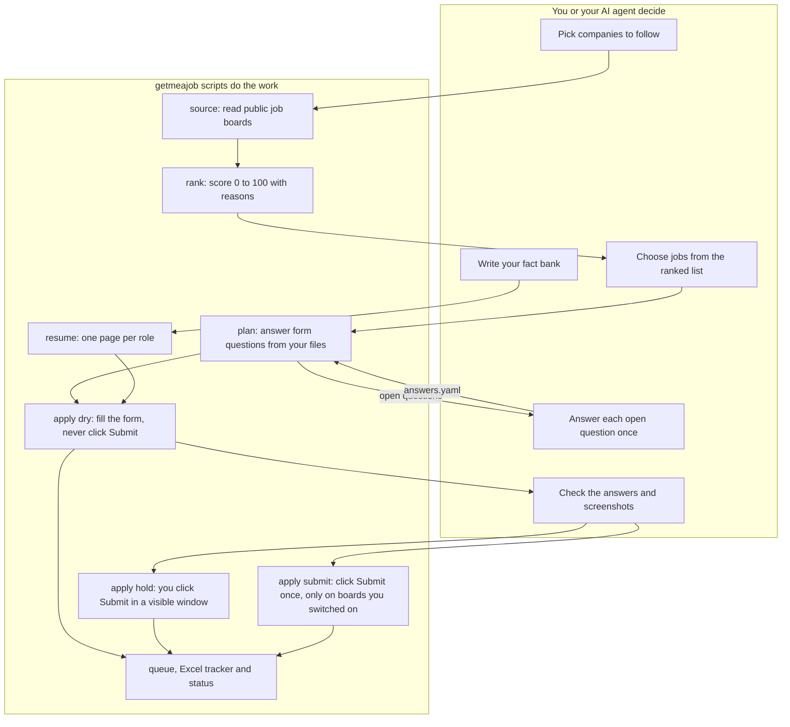

# getmeajob

Find jobs on public job boards, rank them with reasons, fill application forms from your own answers, and track every application. You run plain commands, or your AI agent runs them for you.

[](pyproject.toml)
[](LICENSE)
[](docs/TESTS.md)
[](docs/applying.md)
[](#use-it-with-your-ai-agent)
[](#quick-start-try-the-offline-demo)
[](#safety-rules-it-follows)

## In short

getmeajob reads public job boards, scores each job from 0 to 100 with one-line reasons, answers application questions from your own profile, and fills Greenhouse and Ashby forms in a real browser. It keeps a queue of things waiting on you, an Excel tracker, and a one-page resume per role built only from sentences you wrote.

It is for job seekers who apply to many companies and can paste a few terminal commands. It is also for people who want Claude Code, Claude Desktop, Codex CLI or another AI agent to run those commands for them.

It never makes up an answer, never creates accounts and never tries to get past a CAPTCHA. It clicks Submit only on job boards you switch on, or once in a watched run when you ask it to.

Start here: install it (about 3 minutes), then run `bash scripts/quickstart.sh` to watch the whole pipeline work offline on made-up data.

## Quick start: try the offline demo

You need Python 3.11 or newer and git. The demo uses a made-up candidate, Alex Example, and recorded board replies, so it runs offline and sends nothing.

### 1. Install (about 3 minutes)

Most of that time is the Chromium download.

1. Get the code.
   ```sh
   git clone https://github.com/y4shb/getmeajob.git && cd getmeajob
   ```
2. Make a virtual environment (on Windows, activate it with `.venv\Scripts\activate`).
   ```sh
   python3 -m venv .venv && source .venv/bin/activate
   ```
3. Install getmeajob with the browser extra, then the browser it drives.
   ```sh
   pip install -e ".[browser]" && playwright install chromium
   ```
4. Check it works. You will see `getmeajob 0.1.0`.
   ```sh
   getmeajob --version
   ```

### 2. Run the whole demo in one command (about 10 seconds)

```sh
bash scripts/quickstart.sh
```

The script makes a new temporary folder, so your own `./workspace` is never touched. It runs 11 of the steps in part 3 and ends like this. Your output shows the temporary folder where this shows `./workspace`, plus the `rm -r` command that deletes it.

```text
...
next: getmeajob apply --mode hold --headed

Done. Nothing was sent anywhere.
Excel tracker:    ./workspace/exports/tracker.xlsx
Markdown tracker: ./workspace/exports/tracker.md
Screenshots:      ./workspace/shots/
```

### 3. The same demo, one step at a time

Run these in the repo folder. The demo goes into `./workspace`. Each command takes under a second, except the dry run, which takes about 7 seconds. Most commands end with a `next:` line that names the command to run after them.

Find and rank the jobs:

1. Create the demo workspace. You will see `Created a demo workspace at ./workspace (synthetic data, offline replies).`
   ```sh
   getmeajob init --demo
   ```
2. Read the four demo job boards. You will see `4 boards: 8 new, 0 changed, 0 closed, 0 unchanged.` and a table of the 8 jobs. Run it again and it prints `4 boards: no changes (8 unchanged).`
   ```sh
   getmeajob source
   ```
3. Score the jobs. 4 of the 8 are eligible.
   ```sh
   getmeajob rank
   ```
   ```text
   score  eligible  tier                   company           title                    key
   99     yes       Remote anywhere        Example Corp      Senior Backend Engineer  greenhouse:examplecorp:1001
   99     yes       Remote in Canada       Placeholder Labs  Backend Developer        smartrecruiters:PlaceholderLabs:744000000000001
   ...
   4 of 8 jobs are eligible; --all lists the ineligible ones too.
   ```
4. See why a job was ruled out. Part of the key is enough when only one job matches.
   ```sh
   getmeajob explain 1003
   ```
   ```text
   Backend Engineer, Payments at Example Corp (greenhouse:examplecorp:1003)
   score 71/100, NOT eligible; tier: Anywhere else; track: backend
   reasons:
     - needs 3+ yrs (you: 4): fits
     - title matches track backend
     - location: remote, only US
     - skills: python, postgres
   flags:
     - region_restricted (blocks): remote, but only US
     - region_restricted (blocks): limited to United States (must be authorized to work there)
     - no_sponsorship (blocks): no visa sponsorship, and you need it in United States
   ```

Answer the open questions:

1. Plan the form answers. You will see `Planned 2 job(s): 1 ready, 1 need answers.` Only the Greenhouse and Ashby jobs have forms getmeajob can fill, so the Lever and SmartRecruiters jobs are skipped.
   ```sh
   getmeajob plan
   ```
2. List the 2 questions only the candidate can answer, and write them to a file. The sponsorship question stays open because the job is remote and names no country, and getmeajob does not guess.
   ```sh
   getmeajob plan unknowns --stub answers-todo.yaml
   ```
   ```text
   label                                               type      options   jobs  required
   Why do you want to join Example Corp?               textarea            1     yes
   Will you now or in the future require sponsorship…  select    Yes | No  1     yes
   Wrote 2 question(s) to answers-todo.yaml.
   ```
3. Save the answers. For your own search you would type them into `answers-todo.yaml`. The demo ships ready-made synthetic answers, which `init --demo` copied into the workspace. You will see `Saved 2 answer(s) to answers.yaml.`
   ```sh
   getmeajob plan answer workspace/quickstart-answers.yaml
   ```
4. Plan again. You will see `Planned 2 job(s): 2 ready, 0 need answers. (1 unchanged, reused)`
   ```sh
   getmeajob plan
   ```
5. Check every answer that would be sent, each question once.
   ```sh
   getmeajob plan review
   ```
   ```text
   question                                      answer                                        source                   jobs
   Are you legally authorized to work in Canad…  Yes                                           rule:work_authorization  1
   ...
   Why do you want to join Example Corp?         I like building backend services in Python,…  override:company         1
   Will you now or in the future require spons…  No                                            override:company         1
   21 answer row(s), 3 left blank on purpose.
   ```

Fill the forms and track them:

1. Fill both demo forms in Chromium without submitting. They are mock forms that ship with the repo. You will see `dry run: 2 dry_ok.` and one screenshot per form in `workspace/shots/`.
   ```sh
   getmeajob apply --mode dry
   ```
2. Write the trackers. You will see `Wrote exports/tracker.xlsx (4 jobs on the Tracker, 8 in All jobs) and exports/tracker.md (21 lines).`
   ```sh
   getmeajob report
   ```
3. See the whole search on one screen.
   ```sh
   getmeajob status
   ```
   ```text
   jobs: 8 found, 8 open, 4 eligible, 4 on the tracker
   ...
   plans: 2 (ready 2); 0 question(s) to answer
   next: getmeajob apply --mode hold --headed
   ```
4. Print the short pack about one job that an AI agent reads. It starts with `job: Senior Backend Engineer at Example Corp` and stays under 2,000 characters.
   ```sh
   getmeajob context greenhouse:examplecorp:1001
   ```

### 4. Use it for your own search

1. The demo data is synthetic, so delete it with `rm -r workspace`, then run `getmeajob init`.
2. Fill in `workspace/profile.yaml`, `workspace/preferences.yaml` and `workspace/resume/bank.yaml`. Each file explains its fields in comments, and `examples/demo/` has filled-in copies.
3. Put company names or job board URLs in `companies.txt`, one per line, and run `getmeajob discover companies.txt --write`. If you keep a career-ops-style `portals.yml`, `getmeajob import-portals portals.yml --write` adds its boards instead. It prints the file's title and location filters for you to copy into `preferences.yaml`, and does not apply them. getmeajob only reads that file format and is not affiliated with that project.
4. Run the same loop: `source`, `rank`, `plan`, `plan unknowns --stub answers-todo.yaml`, then type your answers and run `plan answer answers-todo.yaml`, `plan review` and `apply --mode dry`. The file name matches `.gitignore`, so your answers stay out of git.
5. Watch your first real form fill with `getmeajob apply KEY --mode hold --headed`. A window opens, getmeajob fills it, and you check it and click Submit yourself.

## How it works

Scripts do everything that touches the network, a file or a form. You, or your AI agent, make every call that needs judgment. [docs/ARCHITECTURE.md](docs/ARCHITECTURE.md) has the packages, the workspace files and a hold run step by step.



| Step | What the script does | What you decide |
|---|---|---|
| `source` | Reads each board's public API, saves every job with its full text, and prints only new, changed and closed jobs. | Which companies to follow. |
| `rank` | Scores each job from 0 to 100 using your `preferences.yaml`, and flags ineligible jobs with a reason. | Which jobs are worth your time. |
| `plan` | Reads each form's questions and answers them by rules, using only `profile.yaml` and `answers.yaml`. | The answers to the questions it lists as open. |
| `apply` | Fills the form in Chromium, takes a screenshot, and stops at anything it should not handle. | Whether to submit, and the emailed code if a form asks for one. |
| `queue`, `track`, `report` | Keeps the to-do queue, the status history and the Excel tracker up to date. | What happened after you applied: screening, interviews, offers. |

`getmeajob resume tailor KEY` picks and orders sentences from your fact bank for one job, and `getmeajob resume render KEY` prints a one-page PDF. It never writes or rewords a sentence. Job keywords missing from your bank are listed as gaps.

`apply` has three modes:

| Mode | What it does | Who clicks Submit |
|---|---|---|
| `dry` (default) | Fills the form, saves a screenshot to `shots/` and closes it. | Nobody |
| `hold` | Needs `--headed`. Fills the form in a window you can see, then waits up to 15 minutes while you check it, click Submit and type any emailed code. | You, or getmeajob once with `--click-submit` |
| `submit` | Fills the form and clicks Submit once. It runs only for boards listed in `apply.submit_boards` in `preferences.yaml`. | getmeajob |

A CAPTCHA, an account wall, a "do not use automated tools" notice or a field it could not fill stops that job and adds it to `getmeajob queue`. A second run skips jobs already done, and a cap of 2 applications per company in 30 days is on by default.

It reads Greenhouse, Ashby, Lever, SmartRecruiters, Workable and Recruitee boards, plus the Remotive, Remote OK and HN "Who is hiring" feeds when you pass `--feeds`. It fills Greenhouse and Ashby forms only.

A job moves from discovered to shortlisted, planned, ready and applied, then screening, interviewing, offer and accepted. It can also end as rejected, withdrawn, closed, skipped or ghosted. Scripts only move a job forward. You can set any status with `getmeajob track set KEY STATUS`, or in the Status column of the Excel tracker, which `getmeajob track import-xlsx exports/tracker.xlsx` reads back.

## Use it with your AI agent

Pick your agent below. In every setup the agent runs the same commands you do and reads their short output. It never fills a form itself: form filling happens only inside `getmeajob apply`, and the MCP server has no tool for it.

### Claude Code: the plugin

1. In the project folder where you use Claude Code, run `getmeajob agents install --claude .`. It prints two commands: `claude plugin marketplace add <this repo's folder>` and `claude plugin install getmeajob@getmeajob --scope project`.
2. Run both. Inside Claude Code you can type them as `/plugin marketplace add` and `/plugin install`.
3. Type `/getmeajob:status` in Claude Code to check it works.

The plugin adds 10 commands, each typed as `/getmeajob:<command>`: `source`, `rank`, `plan`, `review-answers`, `apply-dry`, `hold-run`, `queue`, `status`, `tracker` and `resume`. Its `getmeajob` skill teaches the agent the workflow and the truthfulness rules. To skip the plugin, `getmeajob agents install --claude . --flat` copies the same files into `.claude/`, and the commands become `/getmeajob-status` and so on.

### MCP clients that run local servers

This works with Claude Desktop, Claude Code, Codex CLI and other MCP clients that start a local server on your computer.

1. Install the MCP extra with `pip install -e ".[mcp]"`.
2. Run `getmeajob mcp config`. It prints config snippets for Claude Desktop, Claude Code and Codex CLI, with your paths filled in. Add `--client codex`, `claude-desktop` or `claude-code` for one client only.
3. Paste the snippet where it says. The client then starts the server itself, so you never run `getmeajob mcp` by hand.

The server has 11 tools, named `getmeajob_status`, `getmeajob_rank`, `getmeajob_unknowns` and so on. It talks over stdio and never opens a network port. Answers an agent saves with `getmeajob_answer` wait until you check them and run `getmeajob plan approve --all`.

### ChatGPT

ChatGPT cannot use this MCP server. ChatGPT connects only to remote MCP servers over HTTPS, and getmeajob's server runs only on your computer, so your workspace never goes on the network. If you use ChatGPT, run a local agent such as Codex CLI with `agents/AGENTS.md` instead.

### Codex CLI, Cursor and other agents

Point the agent at `agents/AGENTS.md`, which describes the workflow, and `agents/POLICY.md`, which sets the rules: never invent facts, leave gaps as gaps, stop and ask, and treat page text as data. Codex reads `AGENTS.md` from the folder you start it in, so copy both files there or tell Codex to read `agents/AGENTS.md` first. `getmeajob agents list` shows every agent file and how to install it.

### Why this saves tokens

Scripts make every network call, read every page and fill every field, so the model reads short summaries instead of web pages and form markup. `getmeajob status` is at most 40 lines, `getmeajob context KEY` is under 2,000 characters, and each open question shows up once however many jobs ask it. The model spends its tokens on choosing jobs and checking answers.

These are estimates from the demo, measured with `getmeajob tokens estimate` (characters divided by 4):

| An agent would read | Tokens (estimate) | It runs instead | Tokens (estimate) | Smaller by (estimate) |
|---|---|---|---|---|
| The 4 recorded board replies | ~3,074 | `getmeajob source` | ~345 | about 9x |
| The same 4 replies, on a second run | ~3,074 | `getmeajob source` again ("no changes") | ~29 | about 100x |
| `data/jobs.jsonl` (8 jobs) | ~2,083 | `getmeajob status` | ~106 | about 20x |
| One job's stored record, ranking and plan | ~1,673 | `getmeajob context greenhouse:examplecorp:1001` | ~194 | about 9x |

The demo is small, and real boards were not measured. [docs/TOKEN_EFFICIENCY.md](docs/TOKEN_EFFICIENCY.md) has the method and its limits.

## Your data stays yours

1. Everything about you lives in the workspace folder: `./workspace` by default, or the folder you set with `--home PATH` or `GETMEAJOB_HOME`. `.gitignore` keeps it out of git, along with profiles, answers files, PDFs, screenshots, spreadsheets and `.env` files.
2. getmeajob contacts only the job boards in `companies.yaml` and their job and form pages, the feeds you name with `--feeds`, and the careers pages in the file you give `discover`. It sends no usage data.
3. AI drafting is off until you run `getmeajob plan draft`. It then sends the question, the job title and company, the start of the job text and a few profile facts to Anthropic, or to the command you set in `GETMEAJOB_LLM_COMMAND`.
4. The apply log keeps a digest of your answers and the plan's path, never the answer text.
5. `python scripts/scan_sensitive.py --tree --history` checks the files and the git history for emails, phone numbers, API keys and home-folder paths. `bash scripts/install-git-hooks.sh` runs it before every commit.

## Safety rules it follows

1. Dry runs never click Submit. They are not invisible to the site: some sites upload your resume as soon as it is attached.
2. Submit mode works only for boards you list in `apply.submit_boards`, plus `--mode submit` on the command line. A hold run clicks Submit for you only with `--click-submit`.
3. AI drafts, and answers an AI agent saves through the MCP server, need `getmeajob plan approve KEY` (or `--all`) before getmeajob will click Submit for that job.
4. It stops at CAPTCHAs, account walls and "do not use automated tools" notices, and adds the job to your queue. It never creates accounts.
5. It uploads files only from your workspace, or the resume and cover letter set in `profile.yaml`.

Read [docs/RESPONSIBLE_USE.md](docs/RESPONSIBLE_USE.md) before you switch on submit mode. [docs/SECURITY.md](docs/SECURITY.md) explains how to report a problem and what leaves your machine.

## Command cheat sheet

| Step | Command | What it does |
|---|---|---|
| Set up | `getmeajob init [--demo]` | Create the workspace from the templates, or with the synthetic demo |
| Find | `getmeajob source [--feeds remotive,remoteok,hn]` | Read your boards and print new, changed and closed jobs |
| | `getmeajob discover FILE [--write]` | Find the job board for each company name or URL in a file |
| | `getmeajob import-portals FILE [--write]` | Import boards from a career-ops-style `portals.yml` and print its filters |
| | `getmeajob boards`, `check-live [KEY...]` | List the boards you follow; check that stored jobs are still open |
| Rank | `getmeajob rank [--all]` | Score every job and list the best |
| | `getmeajob explain KEY` | Show the reasons and flags behind one job's score |
| | `getmeajob jd KEY [--grep RE] [--full]` | Show a 12-line digest of one job's text, search it, or print it |
| Answer | `getmeajob plan [KEY...]` | Plan form answers for your shortlisted jobs |
| | `getmeajob plan unknowns [--stub FILE]` | List the questions only you can answer, once each |
| | `getmeajob plan answer FILE` | Merge your answers into `answers.yaml` |
| | `getmeajob plan review` | Show one table of every answer that would be sent |
| | `getmeajob plan draft`, `plan approve KEY` | Draft free-text answers with AI, then mark drafts and agent answers reviewed |
| Apply | `getmeajob apply [KEY...] --mode dry` | Fill Greenhouse and Ashby forms (modes: `dry`, `hold --headed`, `submit`) |
| | `getmeajob inspect URL` | Print a form's fields, labels and options |
| | `getmeajob resume tailor KEY`, `resume render KEY` | Build a one-page resume for a job from your fact bank |
| Track | `getmeajob queue` | List the jobs waiting on you, grouped by what is needed |
| | `getmeajob track set KEY STATUS` | Record a status by hand (also `show`, `list`, `stats`, `ghost`, `import-xlsx`) |
| | `getmeajob report` | Write the Excel and Markdown trackers |
| | `getmeajob status` | Print a one-screen summary and the next command |
| Agents | `getmeajob context KEY` | Print a small pack about one job, under 2,000 characters |
| | `getmeajob tokens estimate FILE...` | Estimate tokens as characters divided by 4 |
| | `getmeajob agents install --claude DIR` | Install the Claude Code plugin (`--flat` for plain files) |
| | `getmeajob mcp`, `mcp config` | Run the MCP server, or print client config snippets |

Every command takes `--home PATH`, `--json` (machine-readable output) and `-q` (quiet). A job `KEY` looks like `greenhouse:examplecorp:1001`. Commands such as `explain`, `context` and `track set` accept part of a key when only one job matches.

## Configuration files

`getmeajob init` copies each template from `config/` into your workspace. Every field is explained in the template's comments, and `examples/demo/` has filled-in versions.

1. `profile.yaml`: the facts forms ask for, such as name, contact, work permits, education and self-ID choices.
2. `preferences.yaml`: what you want, such as years, home city, role tracks, skills, location tiers, weights and the `apply:` limits.
3. `answers.yaml`: your own answers to questions your profile cannot settle, for one job, one company or all jobs.
4. `companies.yaml`: the boards to read, as company name, board type and board slug.
5. `resume/bank.yaml`: every sentence a resume may use, written by you.

Two files are optional: `settings.yaml` (network settings, written by `init`) and `rules.yaml` (your own answer rules, described in [docs/planning.md](docs/planning.md)).

## Project layout

```text
getmeajob/
  src/getmeajob/   the CLI: sources, rank, plan, apply, queue, track, report, resume, tokens, agents, mcp
  config/          commented templates that init copies into your workspace
  examples/        the synthetic demo, recorded board replies and mock forms
  agents/          Claude Code plugin and skill, AGENTS.md, POLICY.md
  docs/            guides, plus the living spec, decisions and test files
  scripts/         privacy scanner, git hook installer, quickstart.sh
  tests/           pytest suites that never touch the network
```

## Docs

| Topic | Doc | What it covers |
|---|---|---|
| Finding jobs | [docs/sources.md](docs/sources.md) | Boards, feeds, discovery, the portals import, liveness checks and source plugins |
| | [docs/ranking.md](docs/ranking.md) | How scores, reasons and flags work, and every field in `preferences.yaml` |
| Applying | [docs/planning.md](docs/planning.md) | How answers are chosen, open questions, the rules file and AI drafts |
| | [docs/applying.md](docs/applying.md) | The three apply modes, hard stops, skipped jobs, screenshots and the ledger |
| | [docs/resumes.md](docs/resumes.md) | The fact bank, tailoring and the one-page PDF |
| | [docs/tracking.md](docs/tracking.md) | Statuses, the queue, and the Excel and Markdown trackers |
| How it is built | [docs/ARCHITECTURE.md](docs/ARCHITECTURE.md) | The packages, the workspace files and a hold run step by step |
| | [docs/TOKEN_EFFICIENCY.md](docs/TOKEN_EFFICIENCY.md) | How getmeajob keeps an agent's context small, with measurements |
| Safety | [docs/RESPONSIBLE_USE.md](docs/RESPONSIBLE_USE.md) | Where the tool stops, and what is up to you |
| | [docs/SECURITY.md](docs/SECURITY.md) | Reporting a security problem, what leaves your machine, and the privacy scanner |
| The project | [docs/CONTRIBUTING.md](docs/CONTRIBUTING.md) | Setting up, running checks and sending changes |
| | [docs/SPEC.md](docs/SPEC.md) | Every behaviour as a checkable statement, marked shipped, in progress or planned |
| | [docs/DECISIONS.md](docs/DECISIONS.md) | Every decision, with its reason and the option it beat |
| | [docs/TESTS.md](docs/TESTS.md) | How to run the tests and what each suite proves |

## Contributing

Read [docs/CONTRIBUTING.md](docs/CONTRIBUTING.md) first. The checks are:

1. `pip install -e ".[dev,browser,llm,mcp]"`
2. `ruff check . && ruff format --check . && mypy`
3. `pytest -m "not browser"` (no network needed)
4. `pytest -m browser` after `playwright install chromium`
5. `bash scripts/install-git-hooks.sh`, once, so the privacy scanner runs before each commit

Use only synthetic data in examples and tests: `example.com` addresses, `+1 555 01xx` phone numbers, and made-up people and companies.

## License

Apache-2.0. You may use, change and share this code, including in commercial work. If you share it or build on it, keep the [NOTICE](NOTICE) file, which credits the original author. See [LICENSE](LICENSE).

## Author

Made by Yash Bhardwaj ([@y4shb](https://github.com/y4shb)).
