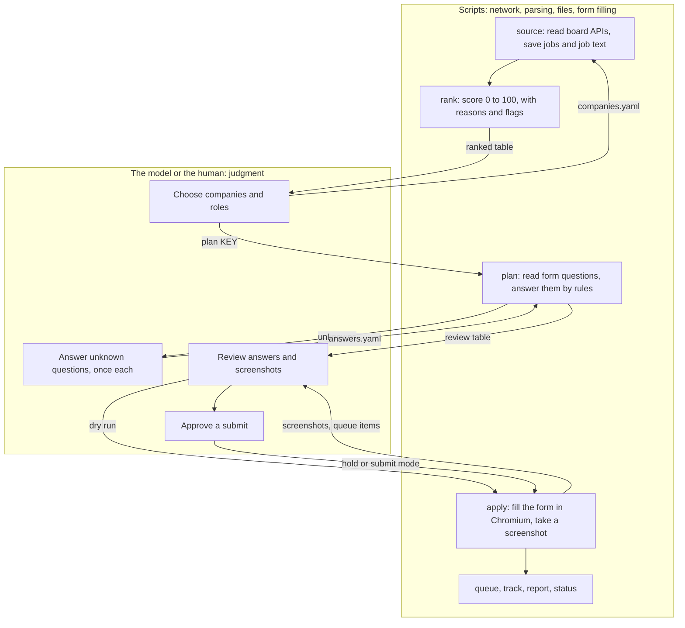
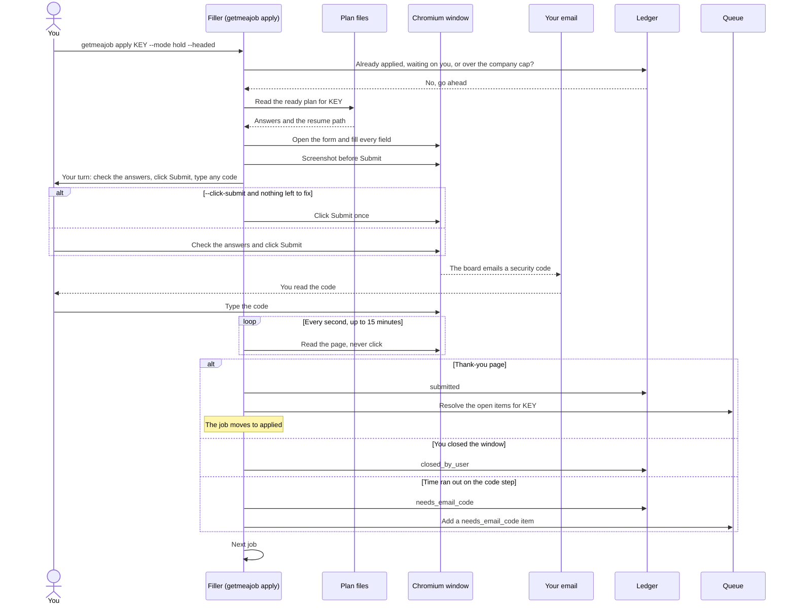
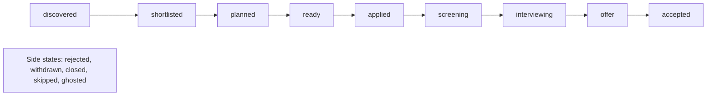

# Architecture

In short: getmeajob is one Python package with one command, `getmeajob`. Scripts do every network call, parse, file write and form click. The model or the human makes the calls that need judgment: which roles to go for, how to answer a question the profile cannot settle, and whether to submit. All state is plain YAML, JSON and JSONL files in one workspace folder.

## The pipeline

The line between the two boxes is the line between code and judgment. Arrows that cross it carry short summaries, never raw pages.

Two rules keep the boundary in place:

1. The model never fills a form. Form filling happens only inside `getmeajob apply`, which a person starts.
2. Answers come only from `profile.yaml` and `answers.yaml`. A script never invents one, and the model's drafts are marked for review (see [planning.md](planning.md)).

## Packages

Each package owns its own `cli.py`, which adds its commands to the one parser in `src/getmeajob/cli.py`.

| Package | What it owns | What it reads | What it writes |
|---|---|---|---|
| `sources/` | The six board readers, three feeds, discovery, the portals import, liveness checks, job text digests | `companies.yaml`, board APIs, feeds, careers pages | `data/jobs.jsonl`, `data/jd/`, `data/runs/`, status events; `companies.yaml` only with `--write` |
| `rank/` | Years parser, title tracks, location tiers, skills, eligibility flags, the score | `preferences.yaml`, stored jobs and job text | `data/ranked.jsonl`, status events |
| `plan/` | Form questions, answer rules, the option matcher, your saved answers, unknowns, optional AI drafts | `profile.yaml`, `answers.yaml`, `rules.yaml`, rankings, form question APIs | `data/schemas/`, `data/plans/`, `answers.yaml` (only `plan answer` and `plan draft`), queue items, status events, `cache/llm/` |
| `apply/` | The Greenhouse and Ashby fillers, hard-stop guards, run policy (duplicates, cap, exclusions, submit opt-in), watching after Submit, `inspect` | Plans, the `apply:` block of `preferences.yaml`, the ledger, status events, the form page | `data/ledger.jsonl`, `shots/`, queue items, status events |
| `queue/` | The revisit queue as people read it | `data/queue.jsonl` | `data/queue.jsonl` (`queue resolve`, `queue add`) |
| `track/` | The status ladder, `track` commands, the ghost sweep, the Excel import, notes, one shared workspace snapshot | `data/events.jsonl`, `exports/tracker.xlsx` | `data/events.jsonl`, `data/notes.jsonl`, `data/queue.jsonl` |
| `report/` | The Excel and Markdown trackers | The workspace snapshot | `exports/tracker.xlsx`, `exports/tracker.md` |
| `resume/` | The fact bank, tailoring, the one-page PDF, keywords, wording lint | `resume/bank.yaml`, job text | `roles/<company>-<title>/` |
| `tokens/` | `status`, `context` and `tokens estimate` | The workspace snapshot, any file you name | Nothing |
| `agents/` | The Claude Code plugin files, prompts and `getmeajob agents` | The `agents/` folder of the repo | Copies of the commands and the skill in `DIR/.claude/`, only with `agents install --claude DIR --flat` |
| `mcp/` | The MCP server (`getmeajob mcp`) and its client config snippets (`getmeajob mcp config`). Its tools are named `getmeajob_<verb>`, and none of them fills or submits a form. | What the CLI functions behind its tools read | What those functions write |

The modules at the top of `src/getmeajob/` are shared by every package:

1. `cli.py` builds the parser and `output.py` prints compact tables, or JSON with `--json`.
2. `workspace.py` finds the workspace and names its files. `store.py` and `files.py` write files atomically and keep the append-only logs. `models.py` and `serial.py` hold the shared data types.
3. `http.py` and `httputil.py` are the one polite HTTP client. `replay.py` answers requests from recorded files in the demo and the tests. `settings.py` reads `settings.yaml`.
4. `textutil.py` turns HTML into text and normalises labels. `yamlio.py` reads YAML with friendly errors. `errors.py` gives every user error a plain message and a hint.
5. `demo.py` is `getmeajob init`.

## The workspace

Everything about you lives here: `./workspace` by default, or the folder given by `--home` or `GETMEAJOB_HOME`. The folder is gitignored.

| Path | Written by |
|---|---|
| `profile.yaml`, `preferences.yaml`, `companies.yaml`, `answers.yaml`, `settings.yaml`, `resume/bank.yaml` | `init`, then you |
| `answers.yaml` (again) | `plan answer`, `plan draft` |
| `companies.yaml` (again) | `discover --write`, `import-portals --write` |
| `rules.yaml` | you (optional) |
| `resume/base.pdf` | you, or `init --demo` |
| `data/jobs.jsonl`, `data/jd/<key>.txt`, `data/runs/<time>.json` | `source` (`check-live` marks closed jobs in `jobs.jsonl`) |
| `data/ranked.jsonl` | `rank` |
| `data/schemas/<key>.json`, `data/plans/<key>.json` | `plan` |
| `data/ledger.jsonl` | `apply` |
| `data/events.jsonl` | `source`, `check-live`, `rank`, `plan`, `apply`, `track set`, `track ghost --apply`, `track import-xlsx` |
| `data/queue.jsonl` | `plan`, `apply`, `queue resolve`, `queue add`, `track set` |
| `data/notes.jsonl` | `track import-xlsx` |
| `cache/http/` | any command that reads the network |
| `cache/llm/` | `plan draft` |
| `roles/<company>-<title>/` | `resume tailor`, `resume render`, `resume pick` |
| `shots/` | `apply` |
| `exports/tracker.xlsx`, `exports/tracker.md` | `report` |

In file names, a job key such as `greenhouse:examplecorp:1001` becomes `greenhouse__examplecorp__1001`. The ledger, the status events, the queue and the notes are append-only, so nothing in them is ever rewritten.

## A hold run, step by step

`getmeajob apply KEY --mode hold --headed` fills the form in a window you can see, then hands it to you. The planner did its work earlier, in `getmeajob plan`; the filler only reads the plan.

A few details the diagram leaves out:

1. With fields it could not fill, or drafts you have not reviewed, `--click-submit` does not click. You still get the window.
2. A CAPTCHA during the wait is recorded as `captcha` and queued. getmeajob never tries to solve it.
3. A page crash is `error`, not `closed_by_user`. Either way the run goes on with the next job.
4. The ledger keeps a digest of the answers and the plan path, never the answer text.

## Status ladder

`source` sets `discovered` and `closed`, `rank` sets `shortlisted`, `plan` sets `planned` and `ready`, `apply` sets `applied`, `check-live` sets `closed`, and `track ghost --apply` sets `ghosted`. The rules live in `transition_allowed` in `src/getmeajob/store.py`:

1. You can set any status, forward or back, with `getmeajob track set` or the Status column of the Excel tracker.
2. Automatic steps only move a job forward, and never set `rejected`, `withdrawn` or `skipped`.
3. Automatic steps close a job only before it reaches `applied`.
4. Automatic steps mark a job `ghosted` only from `applied` or `screening`.
5. Automatic steps never move a job out of a side state. The one exception: `source` reopens a closed posting that comes back, as `discovered`.

## Extension points

1. Job sources: a plugin package adds a source through the `getmeajob.sources` entry point group. [CONTRIBUTING.md](CONTRIBUTING.md) has a small example.
2. Answer rules: your own `rules.yaml` in the workspace is tried before the built-in rules, and a rule with the same `id` replaces a built-in one. The format is in [planning.md](planning.md).
3. Preferences: tracks, location tiers, skills, weights, thresholds and the `apply:` block all live in `preferences.yaml`. Nothing about a person is built into the code. Every field is in [ranking.md](ranking.md).
4. AI drafting: `--provider command` pipes the prompt to whatever command `GETMEAJOB_LLM_COMMAND` names, so any command line model works.
